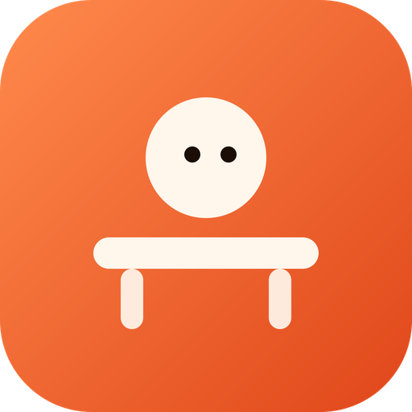

<p align="center">
  
</p>

<h1 align="center">Deskhead</h1>

<p align="center">
  Private AI coworkers on your Mac.<br/>
  They chat, use their own computer, follow routines, and keep working while you do other things.<br/>
  Their brain is <b>Swift</b>, an open model that runs on your Mac. Nothing leaves your computer.
</p>

<p align="center"><i>By DeskHead Inc. Based on <a href="https://github.com/elie222/rakazo">Rakazo</a> by Elie Steinbock (Apache-2.0).</i></p>

---

## Install (Mac)

1. Download **Deskhead-0.1.0-arm64.dmg** from the
   [latest release](https://github.com/LuisSantiagoLopez/deskhead/releases/latest).
2. Open the DMG and drag **Deskhead** to **Applications**.
3. The app is not signed by Apple yet. The first time, **right-click Deskhead → Open → Open**.
   (Or run `xattr -dr com.apple.quarantine /Applications/Deskhead.app` once.)
4. Click **Get started**. Deskhead then, by itself:
   - installs [Ollama](https://ollama.com) if you don't have it,
   - downloads the Swift model with a progress bar (17 GB, one time),
   - starts your private workspace,
   - opens a chat.
5. Create your local account (it never leaves this Mac) and say hi to your first bot.

**Needs:** a Mac with Apple silicon (M1 or newer), **macOS 26**, and **32 GB memory** for the
default model. About 25 GB of free disk.

If the best model can't load on your Mac, Deskhead switches to the next smaller Swift by itself
and tells you. You can also pick one under **Choose a different Swift model** on the first screen.

| Model (all by [UkisAI](https://huggingface.co/ukisai)) | Download | For |
| --- | --- | --- |
| Swift 1.5 27B (`Q4_K_M`) — default | 17.4 GB | 32 GB Macs |
| Swift 1.5 27B Compact (`Q3_K_M`) | 13.4 GB | 24 GB Macs |
| Swift 1.5 Ornith 9B (`Q4_K_M`) | 5.8 GB | 16 GB Macs |

## What it does

| You want | Deskhead |
| --- | --- |
| Named bots that remember you | Persistent bots with their own memory and job |
| A bot that works when you're away | Routines on a schedule, from email or webhooks |
| A bot that uses real apps and sites | Each bot gets its own computer: browser, terminal, files, desktop |
| To step in for passwords and codes | **Take control** of the bot's screen, then hand it back |
| A team of bots | Group chats, @mentions, delegation and subagents |
| Teach it once | **Teach a task**: record yourself doing it, the bot drafts a skill |
| Say what needs your OK | Approval settings per app and action |
| Your apps | MCP servers and OpenAPI tools; Gmail, Slack, GitHub and more with a catalog key |
| Shareable output | Bots build pages: dashboards and docs |
| Privacy | Model, data, and bot computers all run on this Mac |

All of this is Rakazo's work; Deskhead packages it for a one-click local setup with Swift.

## How it works

- **App:** an Electron desktop app (Rakazo's desktop app, rebranded and changed).
- **Workspace:** Rakazo's server (API, worker, web) runs as local processes. Postgres and each
  bot's computer run as small Linux VMs through Apple's open-source `container` runtime. No Docker
  needed on Apple silicon with macOS 26.
- **Brain:** Ollama serves Swift at `http://127.0.0.1:11434/v1`. Deskhead makes it every bot's
  default model (`PI_DEFAULT_PROVIDER=local`). Other models still work: **Settings → Models**.

## Build from source

```bash
pnpm install
pnpm db:generate
pnpm --filter @rakazo/web build
node scripts/build-server-bundle.mjs /tmp/bundle https://github.com/<you>/deskhead/releases/download/<tag>
cp /tmp/bundle/server-bundle.json apps/desktop/build/
pnpm --filter @rakazo/desktop build
cd apps/desktop && npx electron-builder --mac dmg --arm64 --publish never
```

Upload `rakazo-server-darwin-arm64-<version>.tar.xz` to that release: the app downloads it on
first run and checks its SHA-256.

For everything else (self-hosting, Docker, servers, mobile) see
[the original Rakazo README](./docs/RAKAZO_README.md) and [docs](./docs).

## Credits and license

- **Rakazo** by Elie Steinbock and contributors, Apache-2.0: <https://github.com/elie222/rakazo>.
  Deskhead is a fork. The original [LICENSE](./LICENSE) and [NOTICE](./NOTICE) are kept.
  Changed files are listed in [MODIFICATIONS.md](./MODIFICATIONS.md).
- **Swift** models by UkisAI. The 27B models use the
  [Swift Open License v1.0](https://huggingface.co/ukisai/Swift-1.5-Qwen3.8-27b/blob/main/LICENSE)
  (commercial use is limited for companies above US$1M yearly revenue). Ornith 9B is Apache-2.0.
  Deskhead does not ship the weights; Ollama downloads them from Hugging Face.
- **Ollama** (MIT) runs the model.
- New Deskhead code and brand: Copyright 2026 DeskHead Inc., Apache-2.0.

Deskhead is not affiliated with xAI, Rakazo, UkisAI, or Ollama.
